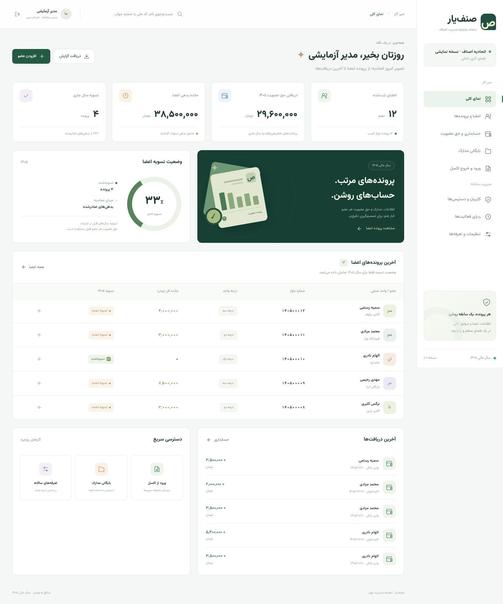
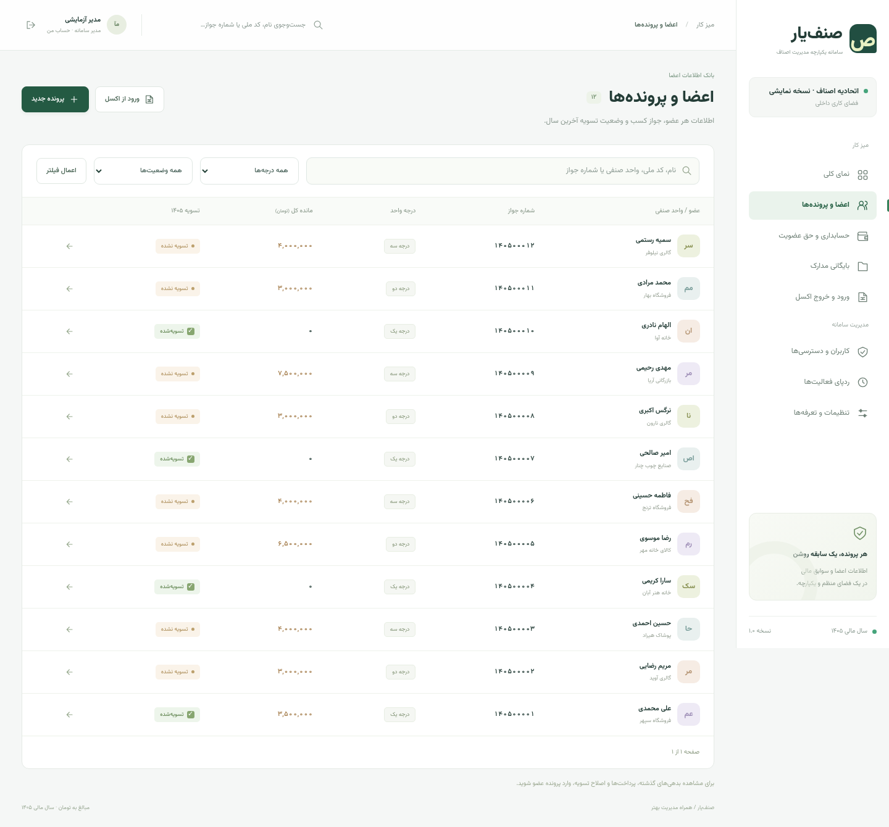
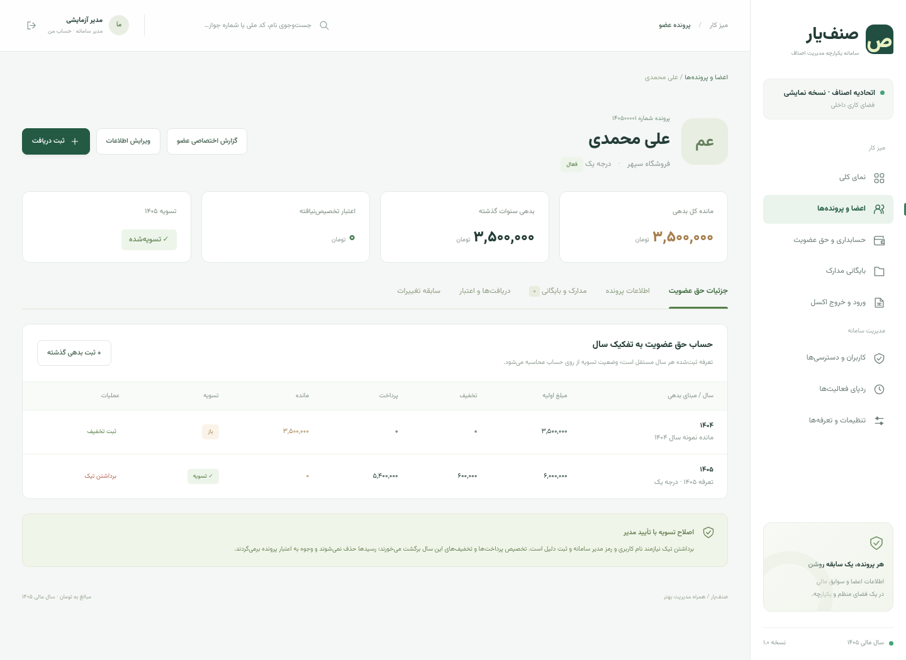
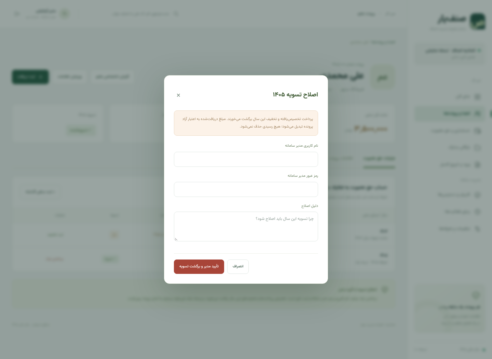
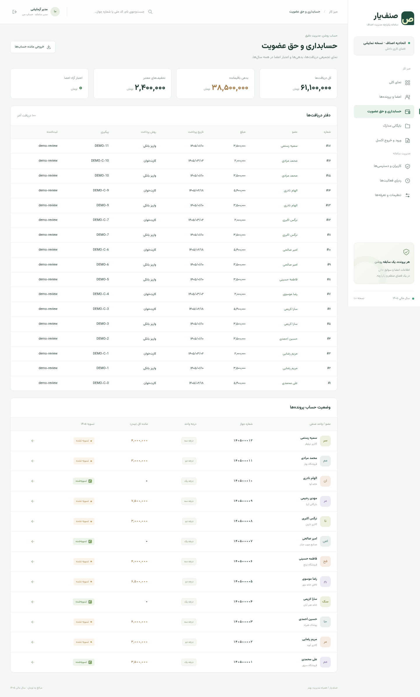
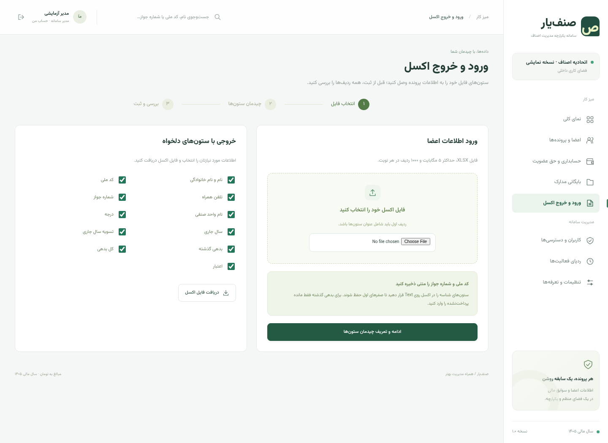
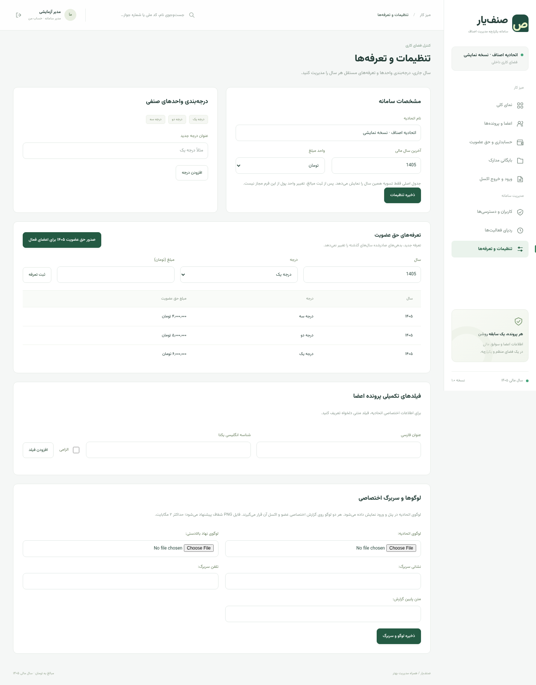
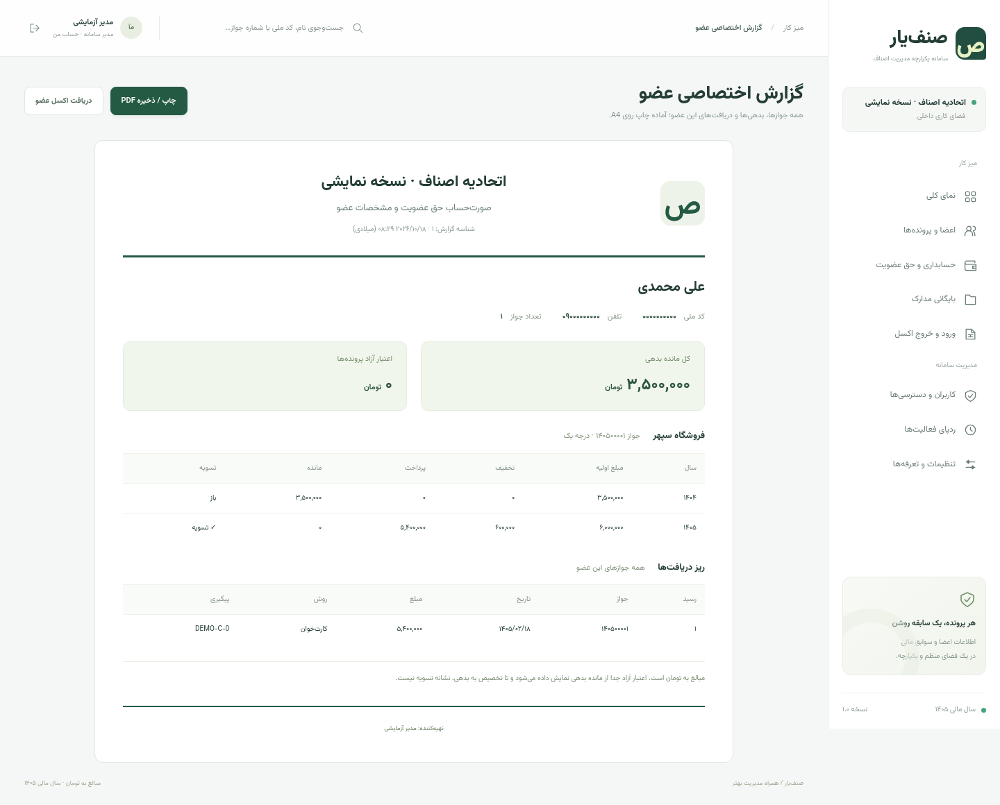
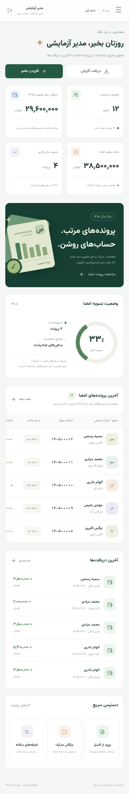

# پیش‌نمایش صنف‌یار

این تصاویر از نسخه اجراشده سامانه گرفته شده‌اند. نام‌ها، پرونده‌ها و مبالغ همگی **ساختگی و مخصوص نمایش** هستند.

> تصاویر مربوط به رابط فعلی‌اند. امکان بارگذاری PNG سربرگ و تنظیم جای تاریخ، شماره و پیوست به نسخه افزوده شده است؛ تصاویر زیر از نسخه پیشین‌اند و این قابلیت را نشان نمی‌دهند.

## داشبورد

## جدول اعضا

جدول اصلی فقط وضعیت تسویه سال جاری را نشان می‌دهد. مانده کل شامل بدهی گذشته نیز هست.

## پرونده و حق عضویت عضو

## تأیید مدیر برای اصلاح تسویه

## حسابداری

## ورود و خروج اکسل

## لوگو و تنظیمات

## گزارش اختصاصی عضو

- [نمونه PDF گزارش عضو](personal-report-sample.pdf)
- [نمونه اکسل گزارش عضو](personal-report-sample.xlsx)

برای دریافت فایل‌ها در صفحه فایل گیت‌هاب از گزینه **Download raw file** استفاده کنید.

## نمای موبایل

